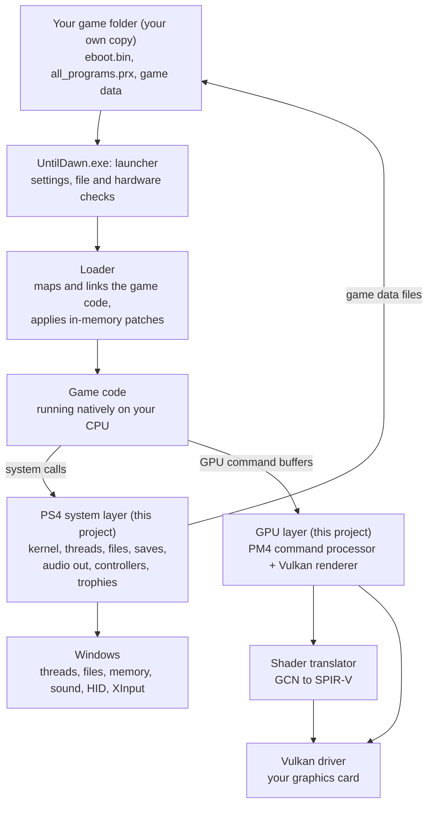
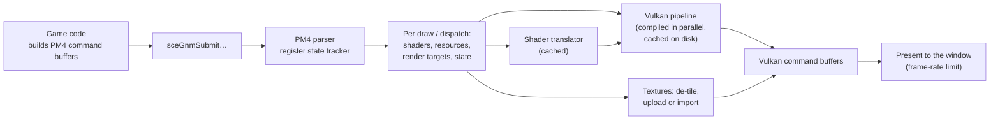

# Technical overview — how the native port works

[← Back to README](../README.md)

This document explains how the Until Dawn native PC port (WIP 0.1.2) runs the original PS4 game on Windows. It
is written for modders, tinkerers and anyone curious about the internals. It describes the design and the
behaviour of the released program; the port's source code is not published yet.

> [!NOTE]
> Nothing here describes or includes the game's own code or assets. Everything below is about this project's
> runtime and about publicly documented formats and hardware (x86-64, AMD GCN, Vulkan, LZ4).

---

## Contents

1. [The big picture](#1-the-big-picture)
2. [Start-up, step by step](#2-start-up-step-by-step)
3. [Running the game's code natively](#3-running-the-games-code-natively)
4. [The PS4 system layer](#4-the-ps4-system-layer)
5. [Memory](#5-memory)
6. [Threads, fibers and timing](#6-threads-fibers-and-timing)
7. [Files and the virtual file system](#7-files-and-the-virtual-file-system)
8. [Graphics: from PS4 GPU commands to Vulkan](#8-graphics-from-ps4-gpu-commands-to-vulkan)
9. [Shader translation (GCN → SPIR-V)](#9-shader-translation-gcn--spir-v)
10. [Audio, video, input and online features](#10-audio-video-input-and-online-features)
11. [The game's data: engine and file formats](#11-the-games-data-engine-and-file-formats)
12. [In-memory patches](#12-in-memory-patches)
13. [Diagnostics and developer mode](#13-diagnostics-and-developer-mode)
14. [Modding: what is possible today](#14-modding-what-is-possible-today)
15. [Glossary](#15-glossary)

---

## 1. The big picture

The PS4 is, at its core, a PC-like machine: an AMD x86-64 CPU (8 "Jaguar" cores) and an AMD GCN graphics chip,
running a FreeBSD-based operating system. Until Dawn's program code is ordinary x86-64 machine code, so a Windows
PC's CPU can execute it directly. **Nothing is emulated on the CPU side.**

What differs between a PS4 and a PC is everything the game *talks to*: the operating system, the system
libraries, the GPU and its command format, the controllers, the file system and the audio hardware. The port
replaces each of those with its own code that runs on Windows.



In numbers (WIP 0.1.2):

| | |
| --- | --- |
| Game functions running natively | about 92,000 (no interpretation, no translation) |
| PS4 system functions the game imports | 748, of which 441 are implemented; the rest are not needed by the game or harmlessly return "success" |
| GPU programs (shaders) in the game | 6,778 unique (6,442 in the data lumps, 336 in the executables), all translated at run time |
| Game files checked at start | 7,634 |

---

## 2. Start-up, step by step

When you double-click `UntilDawn.exe` (no command-line arguments):

1. **Folders and settings.** `Config\`, `Logs\` and `Cache\` are created next to the program if they are
   missing. `Config\settings.ini` is read, or written with defaults. The previous logs are rotated
   (`UntilDawn.previous.log` … `previous-5.log`).
2. **Game-folder check.** The game folder is `Game\` or `game_dir` from the settings. The launcher checks:
   - the SHA-256 of `eboot.bin` and `all_programs.prx` (only the exact 01.03 build is accepted; 01.00 is
     recognised and gets its own message);
   - the title ID and version in `sce_sys\param.sfo`;
   - the presence and **size** of all 7,634 data files.
   Anything wrong produces a message box naming the problem and the files, and the program stops.
3. **Hardware check.** The CPU's instruction sets (the game's code needs AVX, F16C, BMI1, LZCNT, POPCNT, MOVBE
   and SSE4.2), whether Windows saves AVX state, memory size, and later the graphics card's Vulkan features. A
   missing requirement is explained in plain words.
4. **Loading the game code.** `eboot.bin` is parsed (a plain ELF or a fake-signed SELF; encrypted files are
   refused — the program has no decryption code) and its segments are mapped into memory. Relocations are applied
   (about 174,000), and each of the 748 imported system functions is linked to this project's implementation.
5. **In-memory patches** are applied to the loaded code (see [section 12](#12-in-memory-patches)). The file on disk
   is never modified.
6. **Static constructors** (736 of them) run, `all_programs.prx` is loaded when the game asks for it, and the
   game's `main` function is called on a game thread.
7. When the game opens its video output, the **Vulkan renderer** starts: GPU selection and checks, the pipeline
   cache from `Cache\`, the game window (windowed or borderless).

From then on the game runs as it does on a PS4: it calls system functions and submits GPU command buffers, and the
port answers both.

---

## 3. Running the game's code natively

The game's machine code is mapped at its own addresses and executed by the CPU unchanged, apart from the few
patches in [section 12](#12-in-memory-patches). Two differences between the PS4 and Windows have to be bridged:

- **Calling convention.** PS4 code uses the System V x86-64 ABI (as Linux does). Windows uses the Microsoft x64
  ABI. Every function the game calls in the system layer is compiled with the System V convention, so the game
  calls it like any PS4 library function.
- **The red zone.** System V code may keep data in the 128 bytes *below* the stack pointer. Windows does not
  respect that area when it delivers exceptions, so the port avoids using CPU exceptions (traps) on game threads
  where it can; anything that has to interrupt game code at a specific instruction is done with a small
  "detour" stub that preserves the red zone instead.

---

## 4. The PS4 system layer

The PS4's system libraries (libkernel, libc, libSceGnmDriver, libSceAudioOut, libScePad, libSceSaveData and many
more) are **not** used or shipped. The port provides its own implementation of each function the game imports:

| PS4 library area | What the port does |
| --- | --- |
| Kernel: memory, files, time, events | Windows virtual memory, files and timers (sections 5–7) |
| Threads and synchronisation (pthreads, semaphores, event flags, event queues) | Real Windows threads and locks (section 6) |
| libc / C++ runtime | Own implementations of the functions the game imports (strings, numbers, time, character tables, setjmp/longjmp) |
| Fibers | Native Windows fibers |
| Save data | Folders under `savedata\` (section 7) |
| Gnm (graphics driver) | The GPU layer (section 8) |
| Video out | The game window and Vulkan presentation |
| Audio out | Windows `waveOut` (section 10) |
| Pad, user service, system service | Controllers, keyboard, mouse; one signed-in user; English (US); Cross confirms |
| NP (PlayStation Network) and trophies | Signed out; trophies saved locally |
| Dialogs (message, error) | Answered automatically ("OK") |

When the game calls a function that has no implementation, it gets a neutral answer, and the call is listed at
the end of `Logs\UntilDawn.log` ("OS functions with no implementation that the game called"). In WIP 0.1.2 that
list holds 36 functions, all of them networking, font, camera, live-streaming or start-up initialisation calls
the game does not depend on.

---

## 5. Memory

- **PS4 addresses.** The game expects its "direct memory" (the PS4's shared CPU/GPU memory) and several fixed
  regions at specific addresses. The port reserves and maps memory at the same addresses in the Windows process
  (for example the direct-memory area starting at `0x200000000`), so pointers inside the game stay valid.
- **CPU and GPU share memory on the PS4.** On a PC they don't. The renderer imports the game's memory regions
  directly into Vulkan (`VK_EXT_external_memory_host`), so the GPU reads vertex data, constants and textures from
  the same memory the game writes. Data the GPU reads very often is mirrored into video memory.
- **Change tracking.** Windows' write-watch feature reports which 4 KB pages the CPU wrote since the last check.
  The renderer uses it to know which textures and buffers must be refreshed, instead of re-reading everything
  every frame.
- **Safeguards.** A known problem in WIP 0.1.2 is that a few bytes of game memory are occasionally overwritten
  (see Known issues). The port scans for the known damage patterns and repairs the ones it can recognise; those
  repairs are counted at the end of the log (`watch-heap`, `skin-table check`).

---

## 6. Threads, fibers and timing

- Every PS4 thread the game creates (about 31 during play: job schedulers, Havok physics workers, Wwise audio, Bink
  video, file I/O, save data, …) becomes a real Windows thread. Mutexes keep their PS4 types (normal, recursive,
  error-checking, adaptive), and condition variables, semaphores and event flags map onto Windows primitives.
- **Thread-local storage.** PS4 code reads its thread pointer through the `fs` segment register. 64-bit Windows
  does not let a program point `fs` at its own data (it provides per-thread data through `gs`), so those reads
  (about 6,000 sites) are patched to read a Windows thread-local slot through `gs` instead.
- **Fibers** (used by the engine's job system) run as native Windows fibers. Switching stacks by hand would be
  killed by Windows' stack checks and, on newer CPUs, by hardware shadow stacks.
- **The game clock.** The game reads the CPU's time-stamp counter directly (`RDTSC`, about 1,400 sites) and
  assumes it ticks at the PS4's 1.6 GHz. A PC's counter runs at a different rate, so each site is detoured to code
  that returns the counter scaled to 1.594 GHz. Without this, game time would run too fast or too slow.
- **Frame pacing.** The frame-rate limit from `settings.ini` is applied when the game presents a frame.

---

## 7. Files and the virtual file system

The game opens files by PS4 paths. The port translates them:

| PS4 path | Windows location | Access |
| --- | --- | --- |
| `/app0/...` | your game folder (`Game\` or `game_dir`) | read-only |
| `/savedata0/...` | `savedata\<save name>\` next to `UntilDawn.exe` | read/write |
| `/temp0/...` | `temp0\` next to `UntilDawn.exe` | read/write |

- The game folder is never written to.
- The engine's own path schemes (such as `cache:lumps/<name>.core`) are resolved by the game's code to
  `/app0/localcachepink/...` before they reach the file layer.
- Trophy unlocks are stored in `savedata\trophies.bin`.

---

## 8. Graphics: from PS4 GPU commands to Vulkan

On a PS4, the game builds **command buffers** in memory in AMD's PM4 packet format (set registers, set shaders,
draw, dispatch, synchronise, write memory) and hands them to the GPU with `sceGnmSubmitAndFlipCommandBuffers`
and related calls. The port's GPU layer is a **command processor** that reads those buffers and re-creates the
work with Vulkan:



Key points:

- **State tracking.** PS4 draws are described by GPU registers (context, shader and uconfig registers). The
  renderer keeps a copy of all of them and, at each draw, works out the complete state: shaders, vertex inputs,
  textures and samplers (from the GCN resource descriptors in memory), render targets, depth/stencil, blending,
  viewport.
- **Render targets live in memory.** On the PS4 an image *is* a block of memory. The renderer keeps Vulkan images
  for every render target and depth buffer and tracks which memory each one stands for, so a texture read of that
  memory finds the image the GPU last wrote there. When the CPU needs GPU results (for example small buffers the
  game reads back), they are written back to memory.
- **Textures.** PS4 textures are stored in AMD's tiled layouts. The port de-tiles them on the CPU (its own
  implementation of AMD's public addressing equations) and uploads them. Block-compressed formats (BC1–BC7) are
  passed to the GPU as they are.
- **Synchronisation.** The game's cache-flush, wait and end-of-pipe requests become Vulkan barriers and waits, so
  draws that depend on earlier GPU work see its results.
- **Features in use:** dynamic rendering, push descriptors, buffer device addresses, conditional rendering (for
  the game's occlusion-query predication), geometry shaders and tessellation, and a parallel pipeline compiler
  (logical processors minus 2, at least 2, at most 12 threads).
- **Resolution.** The game renders at the PS4's 1920×1080; the result is scaled to the window.
- **Shader / pipeline cache.** Compiled pipelines are saved to `Cache\vulkan_pipelines.bin` at the end of each
  run and loaded at the next start. This is what removes most first-play-through stalls on later runs.

The renderer's requirements (Vulkan 1.3, `VK_EXT_external_memory_host`, `VK_KHR_push_descriptor`, 32 push
descriptors, subgroup operations, BC textures and more) are checked at start; the compatibility tester reports
them in detail.

> [!NOTE]
> The program also contains an experimental second renderer that is not used by default. Everything described
> here is the default renderer.

---

## 9. Shader translation (GCN → SPIR-V)

The game's shaders are machine code for AMD's GCN gen2 GPU architecture (the PS4's "Liverpool" GPU). PC drivers
accept SPIR-V. The port's translator, **gcn2spv**, converts each GCN program into a SPIR-V module when the game
first uses it:

- It decodes every GCN instruction format (scalar and vector ALU, memory, image, export, interpolation,
  cross-lane) and emits equivalent SPIR-V.
- GCN runs 64 threads per wave; PC GPUs run 32 or 64. Cross-lane operations are translated so they give the same
  result on 32-lane hardware.
- Numeric behaviour matches GCN where it matters: shift counts masked to 5 bits, saturating float-to-integer
  conversions, NaN handling in min/max, fused multiply-add where GCN fuses, and so on. The compatibility tester's
  "GPU" section runs about 40 small programs through the translator on your GPU and compares the results with GCN
  behaviour.
- Resources (buffers, textures, constants) are read the way the PS4 reads them: from descriptors in memory, with
  the same address arithmetic.
- Translations are cached in memory per shader and per set of inputs; compiled pipelines are cached on disk.

Translating takes milliseconds; the driver's pipeline compilation is what causes the first-play-through stalls.

---

## 10. Audio, video, input and online features

- **Audio.** The game's own audio engine (Wwise) and mixer run natively as game code. The port provides the PS4
  audio-out ports; the mixed sound goes to your default Windows sound device through `waveOut`.
- **Movies.** The game's own Bink video player runs natively; frames are drawn by the renderer like any other
  texture. The Skip prompt for intro and recap movies is added by the port (see section 12).
- **Controllers.** DualSense, DualSense Edge and DualShock 4 are read directly over USB or Bluetooth HID (no
  drivers or mapping tools), including the touch pad and motion sensors. XInput controllers, keyboard and mouse
  are mapped onto the same PS4 pad state, so the game always sees a DualShock 4.
- **Online.** The game sees a signed-out user and a disconnected network; its "network is disconnected" message
  is answered automatically.

---

## 11. The game's data: engine and file formats

Until Dawn runs on Guerrilla Games' **Decima** engine (an early version). Some facts useful to modders, from
studying the file formats:

| Data | Where | Format |
| --- | --- | --- |
| Most game content (levels, models, textures, animations, scripts, UI movies, shaders) | `localcachepink\lumps\*.core` | Decima "core" lumps in a chunked LZ4 container (below) |
| Streamed data | `localcachepink\streams\` | Streamed by the engine on demand |
| Movies | `Movies\` | Bink 2 (`.bk2`) |
| Sound and music | `audio\` | Wwise sound banks and streams |
| Menus and HUD | inside the lumps | Scaleform GFx 4 movies (ActionScript 3, CLIK components) |
| Textures | inside the lumps | PS4 GNF textures, usually tiled, often BC-compressed |
| GPU programs | inside the lumps and the executables | GCN gen2 machine code |

**The .core chunk container**, as far as it is understood:

```
offset  size   field
0x00    4      magic 0xCB10C183
0x04    4      block size (bytes of decompressed data per block)
0x08    8      total decompressed size
0x10    16     hash
0x20    4 × n  compressed size of each block (n = ceil(total / block size))
...            the blocks, one after another: an LZ4 block, or stored as-is when its compressed size
               equals its decompressed size
```

Inside the decompressed data are Decima's own serialised objects (RTTI-typed resources); their layout is not
documented here.

Physics run on Havok and the engine's job system on fibers; both run natively as game code.

---

## 12. In-memory patches

The port changes the loaded game code in memory at start-up. Every patch first checks that the bytes at its
location are exactly what it expects, and is skipped otherwise. The patches, and why they exist:

| Patch | Why |
| --- | --- |
| Thread-local storage (`fs` → `gs`, about 6,000 sites) | Windows provides per-thread data through `gs`, not `fs` (section 6) |
| Game clock (about 1,400 `RDTSC` sites) | Scale the PC's time-stamp counter to the PS4's rate (section 6) |
| `EXTRQ` (96 sites) | An AMD-only instruction (SSE4a) the PS4's CPU has; replaced by equivalent integer code so the game also runs on Intel CPUs |
| Iteration cap on one physics shape-cast loop | Intel and AMD CPUs round the approximate reciprocal instructions slightly differently, which can make one loop endless on Intel |
| Skinning-table check | Detects and repairs one of the memory-corruption patterns (character "explosions") |
| Movie skip | Adds the Skip prompt to the intro and recap movies (below) |
| `malloc` / `free` routing | The game supplies its own allocator to the system libraries; the port uses it the same way the PS4's libc does |

**The Skip prompt** is a good example of how the port can change the game's UI without shipping game assets: the
game's menus are Scaleform movies. When the engine loads the small movie that shows the legal line over the intro
and recap movies, the port inserts its own ActionScript classes (written for this project) into that movie in
memory. The prompt reuses the game's own button pictures and its own "Skip" text from your game files, so it
looks like part of the original UI.

---

## 13. Diagnostics and developer mode

**Logs.** `Logs\UntilDawn.log` records the start-up checks, hardware, renderer setup, per-minute frame-rate
statistics, long frames (with what caused them), stall reports (where every game thread is if no frame arrives for
8 seconds), the memory safeguard counters and a summary at exit. The previous five sessions are kept.
`Logs\captures\` holds the renderer's own log and small diagnostic files.

**Developer mode** (`developer = 1` in `Config\settings.ini`) turns on capture keys. They are meant for bug
investigation and can write very large files (gigabytes for some of them):

| Key | Captures |
| --- | --- |
| **P** (or F9 / F12) | A screenshot and a draw-by-draw description of the next frame |
| **O** | The same, plus every image the frame used |
| **N** | Four consecutive frames with their render targets (for flicker) |
| **H** | A full replay capture of the next frame (all GPU-visible memory and state); the game pauses for a few seconds |
| **T** | A trace of every system call for the next 600 frames |

> [!WARNING]
> In developer mode the **T** key both clicks the touch pad (as always) and starts a call trace. Leave developer
> mode off for normal play.

Captures go to `Logs\captures\` and contain data from your game; don't post them publicly.

---

## 14. Modding: what is possible today

The port is not yet built for modding, and WIP 0.1.2 has **no mod loader or plugin interface**. What a modder
should know about the current behaviour:

- **Changed game files are refused if their size changes.** The start-up check compares the size of every one of
  the 7,634 data files, and the SHA-256 of both executables. A replaced lump of a different size, or a patched
  `eboot.bin`, stops the program with a "wrong size" or "not the supported version" message. (A same-size edit to
  a data file passes the check.)
- **The game folder is read-only to the game.** Mods can't be written into it by the game, and saves never go
  there.
- **Data formats.** The `.core` container (section 11) is straightforward to decompress. Re-packing modified data
  has not been tested, and the Decima object formats inside are largely undocumented.
- **UI changes** are feasible in the same way as the Skip prompt: Scaleform movies can be modified in memory as they
  load. A settings menu built that way is on the project's plans.
- **Shaders** are translated from the game's GCN code at run time; replacing a shader would need a hook in the
  translator, which does not exist yet.

Possible future directions, if there is interest: a documented way to load replacement files (a "mods" folder
checked before the game folder) without weakening the version check of the original files, and hooks for
replacement textures and shaders. These are ideas, not commitments.

If you are studying the game or the port and find something interesting, please share it in
[GitHub Issues](https://github.com/SuperCatElvis/UntilDawn_PC/issues). Don't post game files, extracted assets or
large parts of the game's code.

---

## 15. Glossary

| Term | Meaning |
| --- | --- |
| **eboot.bin** | The game's main executable (an ELF, wrapped as a SELF on the console) |
| **all_programs.prx** | A second executable module of the game (engine graph programs) |
| **SELF / fake-signed SELF** | The PS4's executable container; "fake-signed" means not encrypted |
| **Import / NID** | A system function the game calls, identified on the PS4 by a hash of its name (NID) |
| **System V ABI** | The calling convention used by PS4 (and Linux) code |
| **Red zone** | 128 bytes below the stack pointer that System V code may use without reserving them |
| **Direct memory** | PS4 memory shared by CPU and GPU, mapped at fixed addresses |
| **PM4** | AMD's GPU command-packet format |
| **Gnm** | The PS4's low-level graphics API (builds PM4 command buffers) |
| **GCN** | AMD's Graphics Core Next GPU architecture; the PS4 uses its second generation |
| **SPIR-V** | The shader format Vulkan drivers accept |
| **Pipeline** | A compiled combination of shaders and fixed GPU state in Vulkan |
| **Tiling** | GPU memory layouts that store image pixels in blocks for faster access |
| **Decima** | The game engine Until Dawn is built on |
| **Lump (.core)** | A Decima data file |
| **Scaleform GFx** | The Flash-based UI technology used for the game's menus and HUD |
| **Bink** | The video codec used for the game's movies |
| **Wwise** | The game's audio engine |
| **Havok** | The game's physics engine |
| **Fiber** | A lightweight, manually switched thread used by the engine's job system |
| **RDTSC** | The CPU instruction that reads the time-stamp counter |
| **EXTRQ** | An AMD-only (SSE4a) bit-field instruction the PS4's CPU supports |
